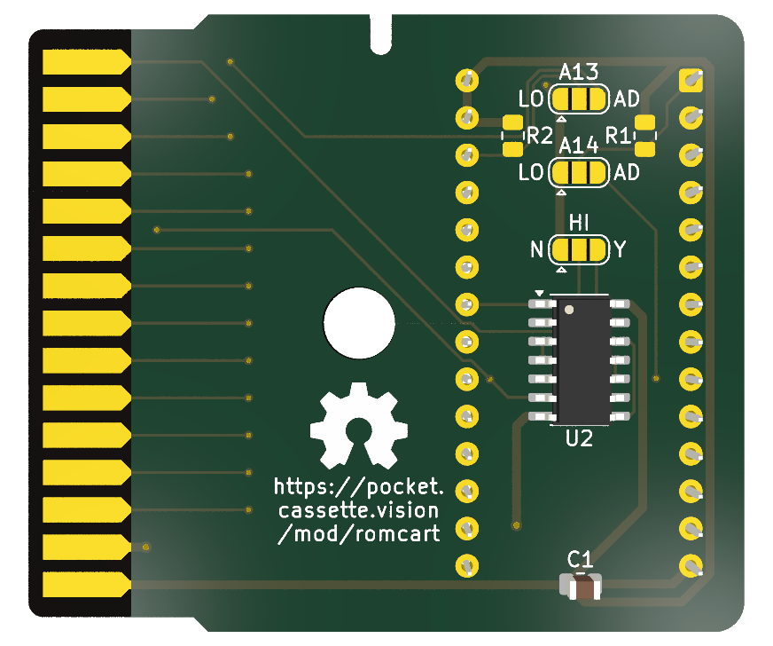

Simple EEPROM cartridge
=======================

This is a KiCad_ project for a simple ROM-based cartridge. With a ROM chip soldered directly to the board, it is a drop-in replacement for authentic gamepock cartridges. With a DIP-28 socket, it won’t fit into the original cartridge shell, but can use the cartridge-window.stl bottom instead.

.. _KiCad: https://www.kicad.org/

Materials
---------

* 1 PCB, ENIG or gold-plated (not HASL)
* 1 DIP-28 socket (optional)
* 1 DIP-28 AT28C64 or AT28C256 EEPROM, or compatible
* 1 SOIC-14 74HCT02 quad NOR gate
* 1 0805 0.1uF ceramic capacitor

Jumpers
-------

There are three configurable jumpers which must be set with solder blobs:

* ``A13=LO|AD``
* ``A14=LO|AD``
* ``HI=N|Y``

For basic configurations, resistors R1 and R2 may be left unpopulated. For multi-cart configurations, they may be needed as pull-ups.

================= === === === === ===
Configuration     A13 A14 HI  R1  R2
================= === === === === ===
8kiB ROM          LO  LO  N   DNP DNP
16kiB ROM         AD  LO  N   DNP DNP
32kiB ROM         AD  AD  Y   DNP DNP
4x8kiB multi-ROM  SW  SW  N   10k 10k
2x16kiB multi-ROM AD  SW  N   10k DNP
================= === === === === ===
